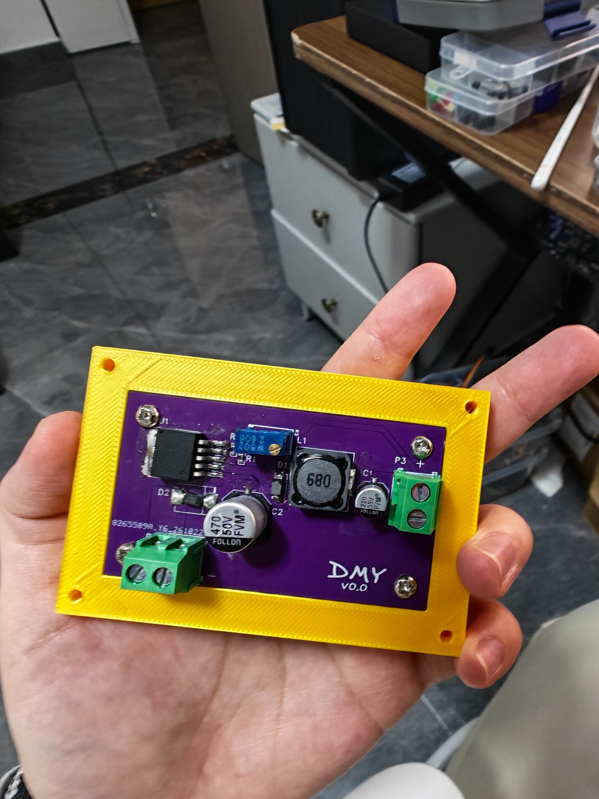

# Adjustable Buck Converter

**DMY · 我的第一个完整硬件作品 · 2026**

基于 LM2596HVS-ADJ 的可调 DC-DC 降压模块。从原理图、PCB 布线、器件采购、手工焊接和调试，到 SolidWorks 外壳建模，都是我自己完成的。已经装配测试的板子可以通过滑动变阻器调节输出电压，示波器观察的结果也符合我的预期。

> **版本说明：** 已装配的原布局 PCB 完成了功能测试；之后修改过布线的 PCB 尚未完成实物验证。仓库中的 2026-10-30 Gerber 和工程文件请在生产前再次核对，不应仅凭本仓库认定为已验证版本。现有外壳按原布局设计，与修改后的 PCB 尚未验证装配兼容性。

## 文件

| 路径 | 内容 |
| --- | --- |
| `hardware/pcb/source/` | 嘉立创EDA工程原文件，保留原始文件名 |
| `hardware/pcb/manufacturing/` | 2026-10-30 Gerber 包，待实物验证 |
| `hardware/enclosure/source/` | SolidWorks 零件与装配文件 |
| `hardware/enclosure/print/` | 3MF 打印文件及外壳迭代版本 |
| `docs/schematic.pdf` | 原理图导出文件 |
| `docs/bom.xlsx` | 元器件清单 |
| `images/` | 项目过程图片 |

外壳文件保留了多个设计迭代，文件名中的“等距”“固定”“上槽左移”表示不同的结构尝试；请根据实际板卡尺寸选择，不要默认所有版本都已装配验证。

## 我的开发经历

第一次画这块板子，元器件都焊上去了，却怎么也不能调压。我先怀疑原理图画错了。ChatGPT 也说我画错了，但我重新对照数据手册后觉得电路没有那个问题，和它据理力争了一番，最后它也改了判断。后来我怀疑是便宜器件的问题，重新采购时把器件都换成了嘉立创的。

第一次调试还因为电源接反烧过杜邦线，所以后续设计加了串联二极管防反接。板子下单后我才意识到，这个方案虽然能防反接，却带来约 0.7 V 的压降。学习搭子给我分享了另一种带限流电阻的方案，提醒我以后要把损耗和故障工况一起考虑；替代方案还需要实际计算和验证。

在下班路上，我又想到自己漏了电源指示灯。它不能代替万用表测量，但能让上电排查直观一些。焊板子时才发现，为了缩短回流路径，我把大器件排得太紧，很多位置不好下烙铁，还好杨工帮忙救场。下一版会同时考虑布线、焊接和维修空间。

这次终于实现了预期功能：滑动变阻器可以调节输出电压，示波器上的观察结果也不错。完整的负载、温升和效率数据还没有整理成测试报告。

一个人做完原理图、布局、采购、焊接和外壳确实累，但沟通成本低。布线不好走时，我可以回头调整自己画的原理图。这次最大的感受是：画 Layout 的人真的应该亲手焊一次板子，拿起烙铁才知道器件间距和操作空间有多重要。测试版手工焊过之后，也更能理解制造环节的难处。

## 下一步

- [ ] 对修改布线后的 PCB 打板并进行功能验证
- [ ] 优化反接保护方案，并核算压降与故障电流
- [ ] 增加电源指示灯
- [ ] 改善大器件周围的焊接空间
- [ ] 验证新 PCB 与外壳的装配兼容性，完善上盖
- [ ] 记录输入、输出、负载、纹波和温升等实测数据

**Designed and built by DMY.**
